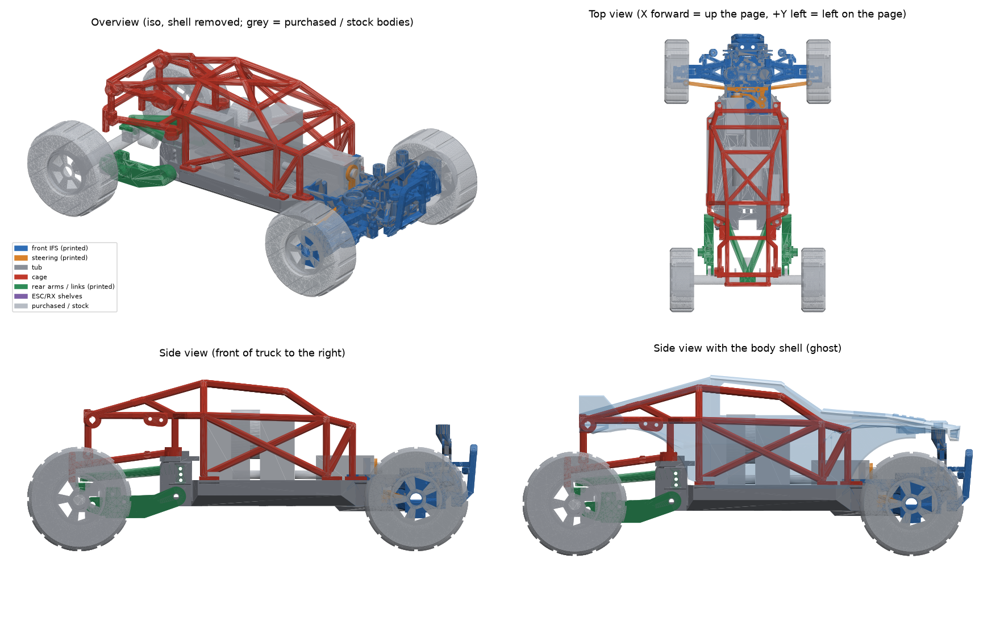
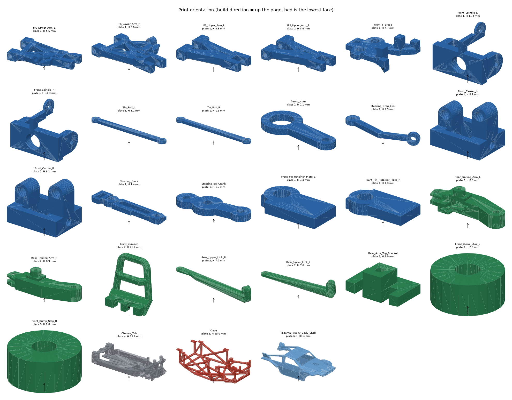
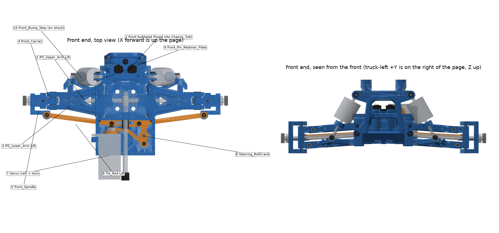
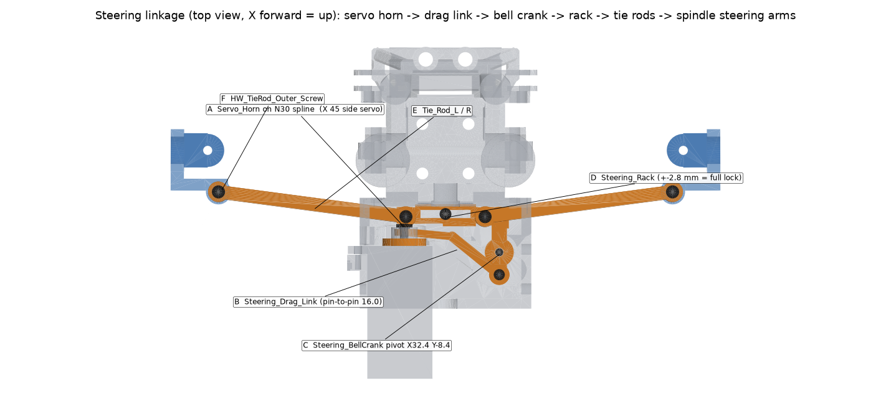
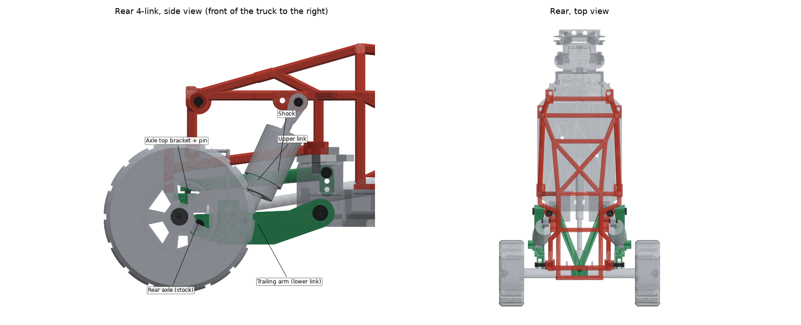

# Assembly guide - SCX30 SCT 107 mm trophy truck (v7 geometry)

Coordinates: X forward, Y left, Z up, mm. Part names are the STL file names (`print/parts/`), hardware names are the `HW_*` bodies (sizes and counts in [parts_list.md](parts_list.md)). Print files and settings: [print/PLATES.md](print/PLATES.md), [print/PRINT_SETTINGS.md](print/PRINT_SETTINGS.md).

> Everything here is derived from the CAD (TUB_V4.md Rev 28-39, FRONT_V3.md updates 6-11, GEARBOX_FIT.md, AUDIT.md) and has **not been built**. Items marked **VERIFY** depend on ASSUMED or UNMEASURED dimensions (shock stroke 7 mm, pinion mesh, ESC 26x18x8, RX 22x14x7, servo wire exit, motor screw pattern, gearbox "12 deep x 25 wide x 28 tall", servo N30 vs Pro): measure the real part before you rely on the printed pocket.

## 0. Tools and consumables
Calipers, 1.0 / 1.2 / 1.5 / 1.6 mm drill bits in a pin vise (or reamers), hobby knife, flush cutters, fine needle-nose and tweezers, 0.9-1.5 mm hex/Phillips drivers for M1.0-M1.6, low-strength threadlock, CA glue, grease for gears, side cutters for Ø1.5 / Ø1.2 wire, zip ties, a tray with a lip (M1.4 screws vanish), a magnet tip.

## 1. Prep and test fits (do before assembling anything)
1. **Print plate 1's small parts first (or a 3-part test batch):** `Servo_Horn`, one `IFS_Lower_Arm`, `Front_Spindle`. Check on the real parts: horn on the servo spline (press fit, target Ø3.93), a Ø1.5 pin in the arm bores, a 4 mm bearing in the spindle seat, the Ø1.2 kingpin in its bore. Set X-Y hole compensation from this (PRINT_SETTINGS.md section 5).
2. **Floor-screw coupon (do not skip):** the bulkhead is held to the tub by 4 x M1.6 x 3 (`HW_Bulkhead_Floor_Screw_1..4`: 2.85 mm under the head after the 5.8 mm raise, through the 1.25 mm web seat into the 1.8 mm tub skid, only about 0.5 mm3 of thread). Print a 20 x 20 x 1.8 mm coupon at the plate-4 settings, thread an M1.6 in and out three times, pull-test by hand. If it strips use M1.6 nuts + washers from below (the tub skid underside is Z -2.7, 13.8 mm above the ground at Z -16.5).
3. **Measure the real purchased parts** and compare with the table in parts_list.md section C: gearbox (case 31 x 25 x 28 assumed), motor (Ø17 x 10, **screw pattern on the gearbox motor face unknown**), servo (hole spacing 10.0, wire exit), shock stroke, pinion size. ESC (30 x 17 x 6) and receiver (20 x 15 x 7) were measured by you and are no longer assumed. **VERIFY** before printing `Chassis_Tub`, `ESC_RX_Shelf_*` and the servo pocket.
4. **Dry-fit stock parts:** rear axle in the trailing arms, shocks on their eyes, wheels on the axles.

## 2. Printed-part clean-up
- Remove the brim first (peel from the bed side, cut with flush cutters, never pry a 1.1 mm link). Let the plate cool before removing parts.
- **Supports:** tree/normal supports use a 0.22 mm Z gap and 2 interface layers: break them away with tweezers, then cut remaining stubs flush with a sharp knife **away from** pin bores and mating faces. Do not sand bore faces or the hinge ears; sand only outer faces, 0.2 mm at most.
- **Bores:** ream every horizontal pin bore (arms, spindles, carriers, trailing arms, bell crank, drag link) with the matching drill by hand: 1.5 mm for the Ø1.5 pins (bores 1.55-1.6), 1.2 mm kingpins. Blow out the dust. Test that each pin slides without play.
- **Tiny parts** (retainer plates 0.7 mm, tie rods 1.1 mm, bell crank 1.2 mm, rack 1.6 mm, horn 1.5 mm, bump stops): handle with tweezers, keep each in its own labelled bag (L/R pairs are mirror images, not identical), and print 2 spares. Pins and M1.0-M1.4 screws: count them out into a tray, never over carpet.
- Screws go into printed pilots without pre-tapping: turn in slowly, stop at the seat, **do not overtighten** (the tub floor is 1.8 mm, the rack/servo pilots 1.2-1.5 mm). A drop of thin CA wicked into a pilot from a pin tip hardens a stripped hole.

## 3. Front end (steering, double-wishbone IFS)

Build each side as a unit before fitting it to the bulkhead. The servo is installed later (4.4): it lives in the tub, not in the bulkhead.

**3.1 Spindle and carrier.**
1. Press the two 4 mm hub bearings (`Front_Bearing_*`, 2 per hub: one outer, one inner) into the `Front_Spindle` seat; fit the Injora `CVD_Outer` axle stub through them.
2. Seat `Front_Carrier_L/R` on the spindle and push the vertical kingpins in: `HW_Front_Upper_Kingpin` (Ø1.2 x 4.7) and `HW_Front_Lower_Kingpin` (Ø1.2 x 3.9). They have **no nut**: a dot of CA on each end retains them, but the spindle must still pivot freely (check by hand, no bind through +-35 deg).
3. Do not glue anything near the bearings.

**3.2 Arms to carrier.** Fit `IFS_Upper_Arm` and `IFS_Lower_Arm` to the carrier with the Ø1.5 x 8.0 outer pins (`HW_Front_Upper_Outer_Pin`, `HW_Front_Lower_Outer_Pin`, along X). The arms must swing freely; no pin protrudes beyond the arm.

**3.3 Bulkhead.** Check the pilots and bores of `IFS_Bulkhead_Convertible` (4 floor pilots at X 44.5 / 52, Y +-3.5; 3 wall screw pilots; hinge tunnels). Ream the hinge tunnels with the 1.5 mm drill.
1. Slide the diff / worm unit (Injora SCX30-34BKFR planetary set with the double-joint shafts, 2/13T front gear) into the bulkhead cavity (X 45.85..50.15 ring, worm X 40..52.2). Check that the ring gear turns freely and the worm-ring mesh is not tight (**VERIFY**: the 13T ring may change the 3.85 mm centre distance).
2. Fit each arm pair with its inboard hinge pins: `HW_Front_Upper_Hinge_Pin` (Ø1.5 x 18.4) and `HW_Front_Lower_Hinge_Pin` (Ø1.5 x 16.8, tip stops 0.72 mm short of the bell crank). Push the pins in from the front.
3. Fit `Front_Pin_Retainer_Plate_L/R` at X 57.05..57.75 over the pin ends with `HW_Front_Retainer_Screw_L/R` (M1.4 x 2.5): this keeps the hinge pins from walking out.
4. Connect the CVD double joints to the diff outputs and the spindle stubs; the shafts must plunge freely.
5. Fit the front shocks (**Injora SCX30-08**, 26 mm extended / 18.3 compressed, 7.7 mm travel): lower eye on the lower-arm lug with `HW_Front_Shock_Lower_Screw` (M1.4 x 4.85 total), upper eye between the two 0.8 mm walls of the bulkhead fork tower with `HW_Front_Shock_Upper_Screw` (M1.4, 3.3 under head, head outside). Ride length 21.63 mm, 20.07 mm at the bump stop, 23.09 mm at droop (3.0 of 7.7 mm used). Slip the TPU `Front_Bump_Stop_L/R` over the shock rod (Ø1.4, ring bore Ø1.5, contact face 13.8 mm from the upper eye; it touches the shock body at +4 deg of arm travel). **VERIFY**: the modelled body Ø8 (with spring) is an estimate; the lower eye is only 0.16 mm from the wheel envelope at droop, so check the real wheel at full lock and droop.
6. Fit the wheels with the stock nuts (`HW_Front_Wheel_Nut_L/R`); +4.5 mm Injora axle puts the wheel 4 mm outboard of the old v2 position.

**3.4 Steering linkage on the bulkhead** (the servo itself goes in after the bulkhead is on the tub, step 4.4).

1. `Steering_BellCrank`: pivot on the Ø1.2 steel pin `HW_Crank_Pivot_Pin` pressed into the floor boss (X 32.4, Y -8.4, Ø1.1 pilot). Input arm 3.4 mm toward -X, output arm 5.4 mm toward +X.
2. `Steering_Rack` (plate Y -10.1..-6.8): the bell-crank output pin `HW_Crank_Out_Pin` rides in the X-slot of the rack; guide it with `HW_Rack_Guide_Screw` into the deck pilot (the screw must not clamp the rack: leave 0.1 mm play). **VERIFY** guide-screw size (model shank Ø1.1, FRONT_V3.md says M1.4).
3. `Tie_Rod_L/R` (1.1 mm): inner end to the rack with `HW_TieRod_Inner_Screw` (M1.4 x 4), outer end to the spindle steering arm with `HW_TieRod_Outer_Screw` (M1.4 x 3.5). Leave the joints free to rotate.
4. Move the rack by hand: free travel +-3.0 mm, and **+-2.8 mm is the intended full lock (about 25 deg outer wheel / 35 deg inner wheel)**. At full lock the lower hinge-pin tip clears the bell crank by 0.72 mm and the tie rod must clear the bulkhead; the spindle only touches the lower arm at -10 deg arm + full lock (accepted). Turn the wheels through the whole range with the shocks fitted: nothing may rub.

**3.4b Front bumper and Y-brace (after the bulkhead is on the tub, before the wheels).** `Front_Bumper` is one part: a bull-bar hoop plus a closed skid oval and a centre plate, all chamfered square 2.6 mm tube. 1. Lay the bumper under the nose: the plate sits on the flat pad under the bulkhead nose floor (X 60.2..63.6, Y +-8.5). 2. Push the two `HW_Front_Bumper_Bolt_L/R` (M1.4 x 14) up from underneath, heads in the Ø2.8 counterbores inside the oval; they pass the plate, the pad, the bulkhead floor skin, the two Ø3.4 posts at (X 61.8, Y +-3.0) and the top skin. 3. Lay `Front_Y_Brace` over the nose: ears over the two bolt ends, front lug on the hoop top bar; put an M1.4 nut `HW_Front_Bumper_Nut_L/R` on each bolt (tighten gently, the bulkhead is thin) and the single `HW_Front_YBrace_Front_Screw` (M1.4 x 3-4) from above into the D1.2 pilot of the hoop top bar. The Y-brace rear feet only rest on the deck (0.1 mm above it, NOT screwed). 4. Check: bumper front face X 66.5 is 1.5 mm behind the tyre front plane, the oval sits 0.5 mm ahead of the pin tips (it keeps the hinge pins from backing out), nothing touches the arms or wheels over full lock and travel (min gaps: lower hinge pin 1.9 mm, retainer plate 1.2 mm). **VERIFY:** hoop and oval sizes are estimates, print orientation untested.

**3.5 Droop and bump stops (front).** Droop: the lower arm lands on the bulkhead at -12 deg (3.0 mm below neutral, -8 deg = 1.5 mm at full lock); check that the arm hits the bulkhead (not the shock or the CVD) before the shock tops out. Bump: the TPU ring on the shock rod meets the shock body at +4 deg of arm travel (+-1.2 mm on the shock); confirm the gap by hand.

## 4. Tub and drivetrain

1. **Tub check:** `Chassis_Tub` (96.1 x 46.0 x 32.8 mm, floor 1.8 mm). Clean the stadium windows and pockets; test-fit the gearbox, motor and servo pockets with the real parts (**VERIFY**: gearbox envelope 31 x 25 x 28; the "12 deep x 25 wide x 28 tall" reading is unconfirmed, the ESC 30 x 17 x 6 and RX 20 x 15 x 7 sizes are user-measured).
2. **Gearbox:** place the Modrax-class gearbox on the floor (the whole stack is 5.8 mm higher than in the earlier revisions: floor top Z +0.9, gearbox top about Z 28.9, output stub Z 9.9 at X 6..15.5; **ground plane is Z -16.5 for all four tyres**). Mesh with a pinion of 11-15T on the motor; check by hand that the mesh is not tight (**VERIFY pinion mesh**) and put a drop of grease on the gears. Fit the rear driveshaft (12.55 deg at full droop) and the front coupler sleeve `HW_Front_Driveshaft_UJ_Gbx` over the gearbox stub (0.05 mm clearance to the servo case at the stub), the Ø2.2 centre shaft (23.6 mm, 6.7 deg) and the Ø3.0 coupler `HW_Front_Driveshaft_UJ_Worm` at the worm end (Ø4.0 pocket in the bulkhead tunnel).
3. **Bulkhead to tub:** set the bulkhead on the floor against the two rear stop blocks (X 23.0..23.9), tab-and-notch location (0.1 mm). Fit the 4 floor screws `HW_Bulkhead_Floor_Screw_1..4` (M1.6 x 3, X 44.5 / 52, Y +-3.5, from the counterbored seats on the raised web at Z +0.8; the tub skid under the nose is Z -2.7..-0.9) - **only as tight as the coupon test showed**, then the 3 wall screws `HW_Bulkhead_Screw_L1` (X 27, Z 2.5), `_R1` (X 27, Z 2.5) and `_R2` (X 33, Z 5.0) from outside (M1.6 x 5, heads sit in the Ø3.3 counterbores). There is no wall screw at +Y X 33 (the servo ear sits there).
4. **Servo, horn and drag link** (VERIFY the servo first: N30 vs N30 Pro, ear hole spacing 10.0 is a pixel estimate, wire exit assumed at the rear face): the servo (`Servo_Ref`: case X 13.4..33.5, Y 1.8..11.7, now Z 0.8..16.6 after the 5.8 mm raise, on its side, spline along X) sits in the 0.4 mm deep pocket in the tub floor (X 13.07..33.8, Y 1.5..12.0) with its ears in the ear slot (X 31.35..33.9, Y 11.3..15.05). Fix it with the 2 x `HW_Servo_Mount_Screw` (M1.0 x 3.5, axis along X at Y 13.1, Z 7.9 and -2.1 = the 10 mm ear spacing); check which printed body carries the pilots on your set. Case clearances: 0.3 mm to the gearbox, 0.3 mm to the gearbox stub. Centre the servo (servo tester or the receiver), press `Servo_Horn` on the spline (press fit; horn arm radius is now 10.7 mm so the horn pin stays on the link plane) and fix it with `HW_Horn_Screw` (the screw from the servo kit; **VERIFY** size, model Ø1.6 vs ~M1.2 in FRONT_V3.md). Connect `Steering_Drag_Link`: A end (X-axis pin) to the horn with `HW_Link_Pin_A`, I end (vertical pin) to the bell-crank input arm with `HW_Crank_In_Pin`, pin-to-pin 16.0 mm. Set the servo end-points so the rack cannot exceed +-2.8 mm (horn about -8.3 / +10.7 deg, bell crank about +-31 deg); the horn arm and the crank input arm must never reach dead centre. The drag link stays planar (pin to pin 16.0 mm, tilt -1.6 to -0.8 deg over the rack travel), so no ball joints are needed. There is no printed wire clip any more (`Servo_Wire_Clip` was removed): route the servo wire along the wall and hold it with a zip tie or a dab of hot glue.
5. **Motor:** there is no clamp part any more. The motor (Ø17 x 10, axis X, Z 23.9, X -21.5..-11.5) screws straight to the gearbox motor face with the gearbox's own motor screws (pattern, size and count UNMEASURED: **VERIFY before print**, check the real gearbox face before you trust the tub's motor pocket). Mesh the pinion with a small backlash, tighten the screws, thread-lock them. Do not run the motor with loose screws.
6. **ESC and receiver pockets:** the printed shelf lids (`ESC_RX_Shelf_L/R`) and their 8 countersunk screws (`HW_Shelf_Screw_*`) no longer exist. The ESC (30 x 17 x 6, measured) stands upright (long side vertical) in the left side pocket and the receiver (20 x 15 x 7, measured) on the floor of the free bay next to it; foam tape on the floor. **TO CONFIRM from the final tub / cage STLs:** how the pockets are now closed (cage members, tape or nothing) and the pocket dimensions; the old numbers (pocket Y 10.2..19.2, 19.1 mm gap in X, 31 mm high) came from the removed shelf design. Route the receiver antenna out of the 2.8 mm antenna/wire slot at the front end of the deck. Wire the ESC to the motor (PH2.0 3P), battery lead and receiver before the cage goes on; keep wires away from the gear mesh and the rear driveshaft droop path (floor Z -4.9).
7. Wiring: servo lead zip-tied along the wall, ESC signal to the receiver; **set the ESC drag brake to 0 %** (BUILD_GUIDE.md warns about the worm drive).

## 5. Rear suspension (4-link on the stock axle)

1. **Axle top bracket:** fit `Rear_Axle_Top_Bracket` on the stock rear axle housing top (X about -66.5). It carries both upper links on one vertical pin `HW_Rear_Axle_Top_Pin` (Ø1.4, 6.5 under the head).
2. **Trailing arms:** `Rear_Trailing_Arm_L/R` to the stock axle ear with the bolt `HW_Rear_Trailing_Axle_Screw` (M2 x 4) from the outside (head on the outer cheek, tip through both cheeks and the axle ear into the hex nut `HW_Rear_Trailing_Axle_Nut` on the inner cheek, 0.15 mm clear). **VERIFY**: the modelled nut (2.4 across flats) is not a real M2 nut: measure the stock SCX30 fastener and the arm's nut seat before printing.
3. Front end of each trailing arm to the tub pad with `HW_Rear_Trailing_Pivot_Screw` (M1.4 x 8, no nut, into the tub pad pilot at X -35). The arm must swing freely.
4. **Upper links:** `Rear_Upper_Link_L/R`: tub end through the pad with `HW_Rear_Upper_Link_Pivot_Screw` (M1.4 x 6) into the tapped link eye (no nut), axle end on `HW_Rear_Axle_Top_Pin`. Both links ride on the same pin: add a drop of grease and a washer if they bind.
   **Anti-squat hole selection (tub pad, 3 holes):** the tub-end boss of each link and the tub pad carry three D1.5 holes at 2.0 mm pitch on an arc of constant link length, so you can change the anti-squat without changing the link length. Use the same hole on both sides. Values assume CG height 21.5 mm and wheelbase 116.5 mm (both ASSUMED, so treat the percentages as relative): **top hole (default) 22.8 %**, middle 54.7 %, lowest 85.9 %. A higher anti-squat figure resists rear-end squat under power (flatter body on throttle) but makes the rear stiffer and can reduce rear grip over bumps; a lower figure lets the rear squat, which usually gives more rear traction. Start at the top hole, move down one hole at a time after a test run. The screw `HW_Rear_Upper_Link_Pivot_Screw` stays M1.4 x 6, pilot D1.5: if a lower hole gives a loose fit, rebuild with a drop of CA.
5. **Shocks (Injora 36 mm big bore, eye-to-eye 36 / full 42 mm, nylon lower end, brass eye bushings; spares: a pack has 2 more):** lower eye in the arm clevis (outer slot to Y 23.15) with `HW_Rear_Shock_Lower_Screw` (M1.4-M1.6 x 4.5, self-tapping into the arm, no nut); upper eye on the hanger tab that runs out from the cage tail post, with the 0.8 mm **spacer sleeve under the eye** and `HW_Rear_Shock_Upper_Screw` (M1.6 x 8, 7.5 under head, into the tab pilot). The shock leans 28.6 deg forward and 2 deg inwards; eye-to-eye 34.48 / 31.05 / 29.18 mm at droop / ride / bump. **VERIFY** before printing the cage and arms: real spring Ø (modelled Ø9.5; Ø10 breaks the 1.5 mm shell margin by 0.1 mm), eye width (3.0 assumed), bore and travel (7-9 mm assumed). The 40 mm and 52 mm Injora shocks do not fit (checked in TUB_V4.md Rev 38).
6. **Sway bar:** buy Ø0.8 steel wire and bend it to the `Ref_Rear_Sway_Bar` shape (cross wire at Z 17.2 plus two levers with a jog; the saddles that carry the cross wire are part of the printed `Cage`). Each lever connects to its trailing arm with a Ø0.9 steel wire drop link with a flattened eye (`Ref_Sway_Drop_Link_L/R`, reference only, not printed). The link end goes in the clevis that is part of `Rear_Trailing_Arm_L/R` and is held by a steel pin Ø1.2 x 3.4 (`HW_Sway_Link_Pin_L/R`, hole Ø1.3, retained with a drop of CA). **VERIFY** the saddle bore size and that the bar turns freely with the arms at droop and bump.
7. **Rear checks:** **the rear droop is now limited by a droop-stop post** on each side of the tub floor (2.2 x 2.3 mm, X -39.6..-37.4, Y 11.9..14.2, printed into the tub) under the upper-link blade: the link lands on it at trailing-arm angle -4.87 deg (axle drop 2.8 mm) so the rear driveshaft never exceeds 13.0 deg (9.0 deg at ride, 3.3 deg at bump); gap at rest 0.53 mm. Total rear axle travel is 6.84 mm (droop 2.8 plus bump 4.04). Check the link lands flat on both posts at the same time; bump: the axle meets the foot of the cage bump-stop post at +7.5 deg (**0.30 mm gap at +7**, 0.58 mm per degree), well before the axle bracket (4.0 mm clear), the shell/wheel (2.48 mm) or the tub; the rear axle at full droop must not touch the tub (rear axle lowest Z -5.5, 9.5 mm above ground).

## 6. Cage
1. **Cage orientation and shape:** the cage is ONE chamfered square-tube part (2.4 mm side, 0.5 mm chamfers, solid; flat roof plane at Z 30.4..31.6 with an X brace crossing at Y 0; one rear hoop at X -78 plus the tail-post frame). It prints inverted (roof plane on the bed). In the assembly the roof rails are the top. Place `Cage` on the tub. Its 6 foot plates: 2 rim plates per side on the tub bosses (X -24.9 / -4.2, Y +-21.5) and one tail foot per side at the tail post (X -35.4), linked out to the lug screw. The cage tail runs inboard (|Y| 11.5) between X -60 and the main-rail jog to make room for the rear shocks.
2. Fix with `HW_Cage_Screw_L1..R3`: **3 x M1.6 per side** (6 total for the rear cage, M1.6 x 6 by the STL; the TUB doc quotes x5: check the tip does not break through). Tighten gently: the tubes are Ø2.3.
3. Check the floating-cage clearances: tail frame at Y +-11.5 (inboard) over the rear links, cage clearance 1.8-2.2 mm to the upper links, the hanger tabs on the tail posts seat the shock tops (spacer sleeve under each eye), the pack cradle rungs (X -71 and -45) sit 0.05-0.35 mm under the pack at Z 18.1 (the battery is user supplied: 44.5 x 20 x 10.5 mm). Check cage to motor (1.3 mm) and to the ESC (1.10 mm) with the real parts.

4. **One-piece cage (`Cage`):** the former `Cabin_Cage` is merged into the rear cage; there is no separate light bar or radiator part and no shelf screws. Fix it with the 12 M2 x 6 pan-head `HW_Cage_Screw_L1..L6`, `R1..R6` (heads Ø3.8 x 1.3; 4.7 mm deep in the tub pilots, 4.5 at the tail). **TO CONFIRM after the final chain:** clearances (shell, shocks, servo, gearbox); the old Cabin_Cage figures no longer apply.

## 7. Body shell
1. Test the shell (rigid 11 mm lift, intact arches, nose extended 8 mm to X 63.5) over the finished chassis: it should drop on the cage without touching the wheels at full steering lock and at full bump/droop.
2. Expected minimum gaps: re-read from the final CAD report (the old Rev 43 figures came from the two-piece cage and the shelf lids and are obsolete). Turn the steering to full lock and compress each corner: any rub means the tyre is larger than the modelled Ø36.0 x 13.5 mm.
3. **Shell retention: front magnets + rear tilt hinge.** No snap clips (`docs/SHELL_CLIPS.md` is superseded). The front is held by 2 pairs of Ø3.0 x 2.0 neodymium magnets (seats on the front shock tower at X 57.3, Y +-7.6 and matching pockets under the hood); the rear tilts on two M2 x 8 hinge screws (`HW_Rear_Hinge_Screw_L/R`) through the Cage ears into the shell lugs (axis along Y at X -64.0, Z 29.0). Holding force and screw access are untested: driver access from inboard is untested (the radiator that blocked it is gone).
4. Paint / finish after the fit check.

## 8. Wheels and final checks
- [ ] Front wheels turn freely on both bearings; nuts secure but not binding.
- [ ] **Steering:** full lock +-2.8 mm rack (about 25 deg outer / 35 deg inner; 3.0 mm is the mechanical limit); the servo end-points set; no rubbing of tyre on arm, tie rod or shell.
- [ ] **Droop stops** (front arm -12 deg = 3.0 mm; rear: the printed tub posts at ta -4.87 deg = 2.8 mm) reached before any part binds; CVD plunge and the rear driveshaft free at both ends.
- [ ] **Bump stops:** front TPU ring touches at +4 deg of arm travel; rear gap 0.30 mm at ta +7 (check with a feeler).
- [ ] **Bulkhead floor screws** (M1.6 x 3) snug but not stripped (coupon-tested), bulkhead does not rock; wall screws seated in their counterbores.
- [ ] **Cage:** M2 x 6 screws tight; no cage tube touches the motor, ESC, links or sway-bar.
- [ ] **Motor screws** tight (thread-lock), motor cannot rotate, pinion/gear mesh smooth with a tiny backlash.
- [ ] **Shell fit** and the chosen attachment; no contact with the wheels in any pose.
- [ ] Gear train: spin the motor 10 turns by hand and check the output; **ESC drag brake 0 %**, correct motor direction (swap two motor leads), 2S/3S cell count and BEC voltage set for the servo.
- [ ] First run on blocks, then low throttle: listen for the gear mesh, check the temperature of the motor and the tub after 1 minute.
- [ ] Re-torque after the first run: M1.4-M1.6 screws in plastic settle.

## Appendix: build order at a glance
1. Test prints + coupons (section 1) -> 2. Print plates 1, 2, 4, 5 (3 TPU, 6 shell last) -> 3. Clean up and ream bores (2) -> 4. Front corner units (3.1-3.2) -> 5. Bulkhead, diff, arms, shocks (3.3) -> 6. Bell crank, rack, tie rods (3.4) -> 7. Gearbox, then bulkhead to tub (4.2-4.3), then the bumper and Y-brace (3.4b) -> 8. Servo, horn, drag link, motor, wiring (4.4-4.7) -> 9. Rear axle, arms, links, shocks, sway bar (5) -> 10. Cage (6) -> 11. Shell (7) -> 12. Wheels + final checks (8).

## Status 2026-11-21 (round 6)
The kit is 124 bodies (28 printed parts on 6 plates). Rear trailing arms are the plate-beam C9 version with the sway-bar clevis tab; the shell has tail fins; the one-piece `Cage` has 12 M2 x 6 screw points (screw-3 pad added). The rear tilt hinge is at X -64.0, Z 29.0. There is no `Servo_Wire_Clip`, `ESC_RX_Shelf_L/R` or `Cabin_Cage`. Items marked TO CONFIRM above still need a physical fit check.

## Status 2026-11-21 (round 7)
124 bodies, 28 printed parts. Rear trailing arms are the D3 plate-beam version (deeper flat beam, mirrored sway-bar clevis tab, Ø1.2 steel pin); the shell has a rear arch (circle R 21.1) and tail fins; the tub has one rib lattice; the one-piece `Cage` sits on foot bosses (12 M2 x 6 screws). Hinge at X -64.0, Z 29.0. No wire clip, shelves or `Cabin_Cage`.

## Status 2026-11-21 (final round)
124 bodies, 28 printed parts. The rear track is 2.1 mm wider (1.05 mm per side: rear axle Y +-32.55, rear wheels Y 30.05..43.55). The trailing arms are the arm_d4 version (1158.8 mm3, shock ear beefed up, still 8.9 mm tall, 240 mm2 flat on the bed); the arm pivot screw is 1.05 mm longer (11.05 under head, 12.15 total: buy M2 x 12, not M2 x 10). Shock lower eye slot, axle-screw head seat and axle nut all moved out by the same 1.05 mm.
