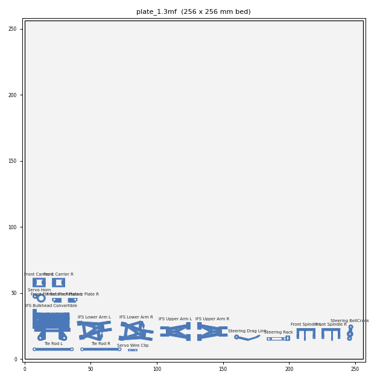
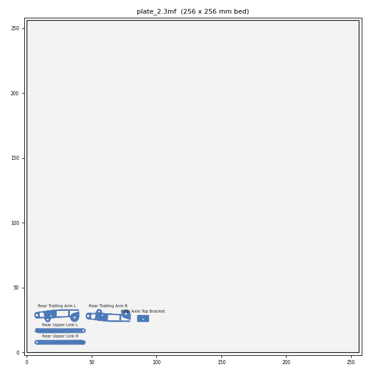
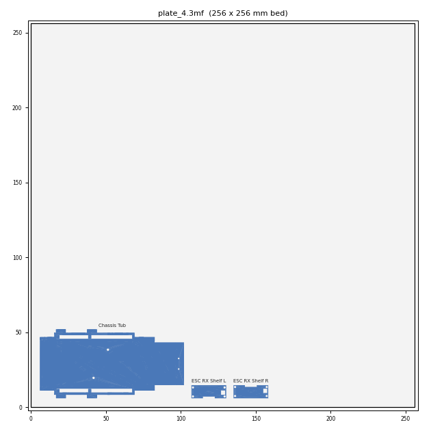
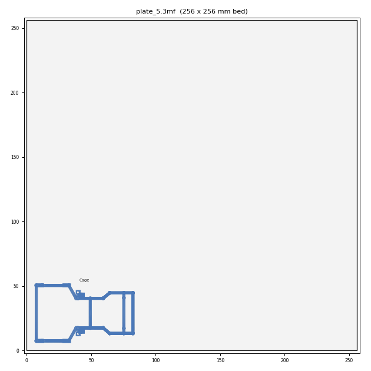
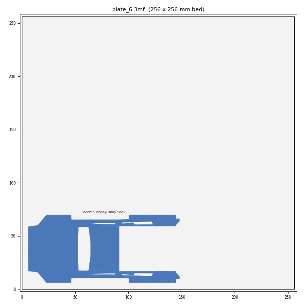
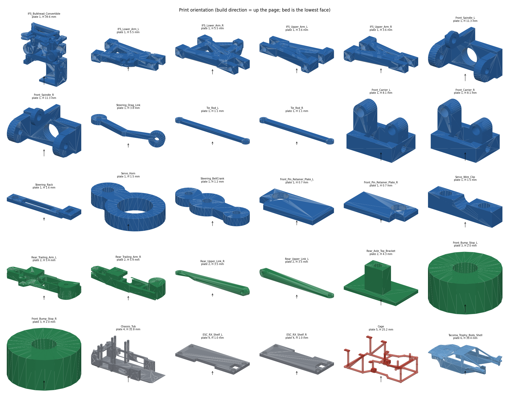

# Print plates (Bambu Studio 3MF)

Bed assumed **256 x 256 mm** (H3C exact model and bed unconfirmed). Layout is generated by `print/make_plates.py` (`--bed W H` re-packs for a bigger bed). Files: `print/plate_N.3mf` (orientation baked into the mesh, one object per part, per-object settings in `Metadata/model_settings.config`), `print/oriented/*.stl` (the same oriented parts as STL, float32 round-trip checked), `print/plates_report.json`, `print/slicer_estimates.json`, `docs/plate_N.png` (layout previews). All 6 plates were opened with `BambuStudio --info` (manifold = yes, 1 part per object) and sliced headless once (see numbers below).

**Source geometry:** `print/parts/*.stl` is authoritative. The generator uses `stl/v4`/`stl/v3` copies only while their volume equals the matching `print/parts` file (same shape, assembly frame); `Chassis_Tub` and `Cage` in stl/v4 were regenerated after print/parts and no longer match, so those two come from print/parts. Re-run `print/make_plates.py` after refreshing print/parts.

## Plate table

| Plate | Contents (qty) | Material | Layer | Walls / infill | Orientation (bed face) | Supports | Slicer estimate* | Heuristic estimate** |
|---|---|---|---|---|---|---|---|---|
| 1 | Bulkhead; lower arm L/R; upper arm L/R; carrier L/R; spindle L/R; retainer plate L/R; rack; bell crank; drag link; tie rod L/R; servo horn; wire clip (18 parts) | PETG-CF (PA12-CF / PAHT-CF if you have a dry box) | 0.12 mm | 4-6 walls / 100 % | arms/links/plates flat; bulkhead rear face down (nose up); spindles X-face down; carriers Y-face down | bulkhead: tree, may touch the part; arms: normal, plate only (about 15-55 mm2 of overhang each); spindle/carrier: tree; flat parts none | 3h 21m 26s, 11.8 cm3 = 15.3 g, 348 layers | 3.3 h, 13.9 g |
| 2 | Trailing arm L/R; upper link L/R; axle top bracket (5 parts) | PETG-CF (PA-CF if available) | 0.16 mm | 6 walls / 100 % | arms side-face down; links flat; bracket upside down | tree/normal on the trailing arms (they overhang on the part itself), plate-only on the R link | 26m 11s, 2.0 cm3 = 2.5 g, 40 layers | 0.3 h, 2.4 g |
| 3 | Front bump stop L/R (2 parts, TPU) | TPU 95A | 0.16 mm | 3 walls / 100 % | rings flat | none | 1m 12s, 0.1 cm3 = 0.1 g, 12 layers | 0.1 h, 0.1 g |
| 4 | Chassis tub; ESC/RX shelf L/R (3 parts) | PETG-CF | 0.2 mm | 4 walls / 100 % | floor on the bed; shelves flat | tub: tree (plate preferred) for the deck/tail/arches, shelves none | 2h 29m 16s, 13.3 cm3 = 17.3 g, 214 layers | 1.0 h, 16.2 g |
| 5 | Cage (1 part) | PETG (tough) or PETG-CF | 0.16 mm | 4 walls / 100 % | upside down: roof rails + cross tube on the bed | normal/tree from the plate under tail frame, rungs and feet | 1h 43m 9s, 6.8 cm3 = 8.9 g, 157 layers | 0.8 h, 4.7 g |
| 6 | Body shell (1 part) | PETG (PLA also fine) | 0.2 mm | 3 walls / 10 % gyroid | sill rim on the bed, roof up | tree supports from the plate fill the cabin and hood underside | 5h 37m 53s, 29.1 cm3 = 36.9 g, 197 layers | 2.0 h, 37.5 g |

\* Bambu Studio 2.x headless slice with the per-object settings of the 3MF and the **default** machine/filament/process profile (PLA speeds, no printer chosen), so time scales with your real printer and filament; filament volume includes supports. Mass = volume x density (PETG-CF 1.30, TPU 1.21, PETG 1.27 g/cm3).
\** Volume-based guess from `make_plates.py` (model + estimated support volume at 12 % fill, throughput per layer height). Use the slicer number once the printer profile is chosen.

Total with the slicer numbers: **13.7 h, 63 cm3 filament (about 81 g)** for the whole kit, shell included (the shell is 5.6 h and 29 cm3 of that, 54 % of it tree support).

## Per-part verification (after orientation and float32 export)

`print/verify_plates.py` reloads every 3MF and oriented STL: watertight, volume > 0, on the bed (z min 0), inside the bed, bounding boxes >= 2 mm apart (packer uses 5 mm). Overhang = area of faces steeper than 45 deg from vertical (excluding the bed face); "on part" = the share whose straight-down ray hits the part itself first, so supports there cannot start on the build plate (those parts use tree supports that may touch the part; the rest are plate-only).

| Plate | Part | Bed-contact area (mm2) | Height (mm) | Overhang area (mm2) | of which on the part | Support | Brim | Volume (mm3) |
|---|---|---|---|---|---|---|---|---|
| 1 | IFS_Bulkhead_Convertible | 169.0 | 39.6 | 932.1 | 646.3 | tree-any | 5 | 4475.9 |
| 1 | IFS_Lower_Arm_L | 25.5 | 5.5 | 220.6 | 16.9 | build-plate | 0 | 586.9 |
| 1 | IFS_Lower_Arm_R | 25.5 | 5.5 | 220.6 | 16.9 | build-plate | 0 | 586.9 |
| 1 | IFS_Upper_Arm_L | 35.3 | 3.6 | 172.4 | 18.9 | build-plate | 0 | 473.2 |
| 1 | IFS_Upper_Arm_R | 35.3 | 3.6 | 172.4 | 18.9 | build-plate | 0 | 473.2 |
| 1 | Front_Spindle_L | 28.0 | 11.3 | 41.9 | 13.0 | tree-any | 3 | 275.0 |
| 1 | Front_Spindle_R | 28.0 | 11.3 | 41.9 | 13.0 | tree-any | 3 | 275.0 |
| 1 | Steering_Drag_Link | 2.3 | 3.8 | 31.7 | 1.3 | build-plate | 4 | 42.9 |
| 1 | Tie_Rod_L | 59.8 | 1.1 | 0.0 | 0.0 | none | 0 | 65.8 |
| 1 | Tie_Rod_R | 59.8 | 1.1 | 0.0 | 0.0 | none | 0 | 65.8 |
| 1 | Front_Carrier_L | 45.6 | 8.1 | 18.3 | 15.0 | tree-any | 0 | 180.4 |
| 1 | Front_Carrier_R | 45.6 | 8.1 | 18.3 | 15.0 | tree-any | 0 | 180.4 |
| 1 | Steering_Rack | 18.7 | 1.6 | 9.0 | 0.0 | none | 0 | 27.7 |
| 1 | Servo_Horn | 31.9 | 1.5 | 0.0 | 0.0 | none | 0 | 47.9 |
| 1 | Steering_BellCrank | 37.2 | 1.2 | 0.0 | 0.0 | none | 0 | 44.6 |
| 1 | Front_Pin_Retainer_Plate_L | 20.5 | 0.7 | 0.0 | 0.0 | none | 0 | 14.0 |
| 1 | Front_Pin_Retainer_Plate_R | 20.5 | 0.7 | 0.0 | 0.0 | none | 0 | 14.0 |
| 1 | Servo_Wire_Clip | 9.0 | 1.5 | 0.0 | 0.0 | none | 0 | 12.4 |
| 2 | Rear_Trailing_Arm_L | 159.2 | 5.4 | 50.4 | 43.3 | tree-any | 0 | 586.2 |
| 2 | Rear_Trailing_Arm_R | 159.2 | 5.4 | 50.4 | 43.3 | tree-any | 0 | 586.2 |
| 2 | Rear_Upper_Link_R | 114.3 | 3.5 | 46.8 | 3.2 | build-plate | 0 | 305.6 |
| 2 | Rear_Upper_Link_L | 136.0 | 3.5 | 22.5 | 3.2 | build-plate | 0 | 311.6 |
| 2 | Rear_Axle_Top_Bracket | 46.6 | 4.3 | 0.0 | 0.0 | none | 0 | 42.7 |
| 3 | Front_Bump_Stop_L | 13.3 | 2.0 | 0.0 | 0.0 | none | 0 | 26.6 |
| 3 | Front_Bump_Stop_R | 13.3 | 2.0 | 0.0 | 0.0 | none | 0 | 26.6 |
| 4 | Chassis_Tub | 3066.1 | 32.8 | 1342.1 | 320.8 | build-plate | 8 | 11188.5 |
| 4 | ESC_RX_Shelf_L | 175.3 | 1.0 | 0.0 | 0.0 | none | 0 | 175.3 |
| 4 | ESC_RX_Shelf_R | 175.3 | 1.0 | 0.0 | 0.0 | none | 0 | 175.3 |
| 5 | Cage | 29.1 | 25.2 | 847.5 | 260.2 | tree-any | 6 | 2913.3 |
| 6 | Tacoma_Trophy_Body_Shell | 511.1 | 39.4 | 5268.7 | 454.5 | tree-build-plate | 8 | 13593.0 |

Result: 30/30 parts watertight, in-bed, non-overlapping. Weakest adhesion: `Steering_Drag_Link` (2 mm2 contact, because its pin bosses stand proud): 4 mm brim and a few support dots; `Front_Bump_Stop` rings 10.7 mm2 each (TPU, slow, brim optional); `Cage` 22 mm2 of line contact: 6 mm brim, print slowly for the first layers.

## Layout previews

### plate_1

### plate_2

### plate_3

### plate_4

### plate_5

### plate_6

## Orientation overview

## Alternatives and notes

- **Shell:** sill-down with tree supports (this plate). The supports are heavier than the shell (15 cm3). Nose-down (X+ face on the bed, 142 mm tall) needs almost no support (487 mm2 overhang) but is tall and thin-walled; the headless slicer rejected it with the default machine (height), so it is untested. If the H3C is a small-height model use sill-down.
- **Merge plates on a bigger bed:** `python print/make_plates.py --bed 350 320` keeps one plate per material/layer group and only packs more per plate if the group is split. Plates with different layer heights are never merged (per-object layer height does work in Bambu Studio, see below, but is easier to get wrong).
- **TPU plate:** the two bump stops take 1 minute: print them together with a spare pair.
- **Spares:** duplicate the small-parts rows in Bambu Studio (right click -> clone) before slicing plate 1.
