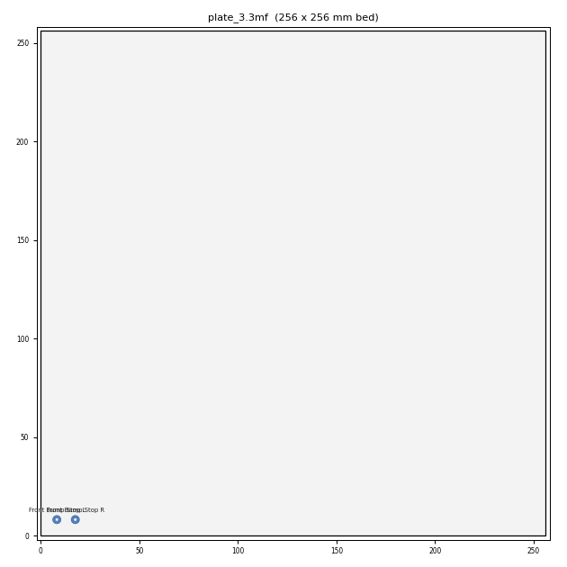

# Print plates (Bambu Studio 3MF)

Bed assumed **256 x 256 mm** (H3C exact model and bed unconfirmed). Layout is generated by `print/make_plates.py` (`--bed W H` re-packs for a bigger bed). Files: `print/plate_N.3mf` (orientation baked into the mesh, one object per part, per-object settings in `Metadata/model_settings.config`), `print/oriented/*.stl` (the same oriented parts as STL, float32 round-trip checked), `print/plates_report.json`, `print/slicer_estimates.json`, `docs/plate_N.png` (layout previews). All 6 plates were opened with `BambuStudio --info` (manifold = yes, 1 part per object) and sliced headless once (see numbers below).

**Source geometry:** the plates are built from the CAD output in `stl/v4` + `stl/v3` (assembly pose); `print/parts/*.stl` is a mirror of exactly the printable files, rewritten by `print/make_plates.py` on every run, and `print/oriented/*.stl` holds the print-oriented copies. Re-run `print/make_plates.py` after any geometry change.

## Plate table

| Plate | Contents (qty) | Material | Layer | Walls / infill | Orientation (bed face) | Supports | Slicer estimate* | Heuristic estimate** |
|---|---|---|---|---|---|---|---|---|
| 1 | Lower arm L/R; upper arm L/R; carrier L/R; spindle L/R; retainer plate L/R; rack; bell crank; drag link; tie rod L/R; servo horn; Y-brace (17 parts; the front bulkhead is fused into the chassis tub on plate 4) | PETG-CF (PA12-CF / PAHT-CF if you have a dry box) | 0.12 mm | 4-6 walls / 100 % | arms/links/plates flat; spindles X-face down; carriers Y-face down | arms: normal, plate only (about 15-55 mm2 of overhang each); spindle/carrier: tree; flat parts none | 3h 25m 52s, 11.8 cm3 = 15.4 g, 358 layers | 1.1 h, 5.0 g |
| 2 | Trailing arm L/R; upper link L/R; axle top bracket; front bumper (6 parts) | PETG-CF (PA-CF if available) | 0.16 mm | 4-6 walls / 100 % | arms side-face down; links flat (boss side up); bracket upside down; bumper oval/plate flat, hoop up | tree/normal on the trailing arms (they overhang on the part itself), plate-only on the links; bumper: tree under the hoop arch | 43m 10s, 3.1 cm3 = 4.0 g, 115 layers | 0.8 h, 5.1 g |
| 3 | Front bump stop L/R (2 parts, TPU) | TPU 95A | 0.16 mm | 3 walls / 100 % | rings flat | none | 1m 12s, 0.1 cm3 = 0.1 g, 12 layers | 0.1 h, 0.1 g |
| 4 | Chassis tub (1 part) | PETG-CF | 0.2 mm | 4 walls / 100 % | floor on the bed | tub: tree (plate preferred) for the deck/tail/arches | 2h 30m 56s, 13.1 cm3 = 17.1 g, 215 layers | 1.2 h, 21.7 g |
| 5 | Cage (1 part, one-piece) | PETG (neat tough PETG recommended for vertical Z-layer posts) | 0.16 mm | 4 walls / 100 % | one-piece Cage printed inverted (roof down), 35.6 mm tall, about 200 mm2 bed contact on the foot bosses: 4 mm brim (6 if it lifts), slow hot first layers | tree supports for the one-piece cage (mostly under the tail and cross bars) | 3h 51m 54s, 17.1 cm3 = 21.8 g, 289 layers | 1.5 h, 11.4 g |
| 6 | Body shell (1 part) | PETG | 0.2 mm | 3 walls / 10 % gyroid | sill rim on the bed, roof up | tree supports from the plate fill the cabin and hood underside | 5h 40m 36s, 29.4 cm3 = 37.4 g, 197 layers | 2.1 h, 39.6 g |

\* Bambu Studio 2.x headless slice with the per-object settings of the 3MF and the **default** machine/filament/process profile (PLA speeds, no printer chosen), so time scales with your real printer and filament; filament volume includes supports. Mass = volume x density (PETG-CF 1.30, TPU 1.21, PETG 1.27 g/cm3).
\** Volume-based guess from `make_plates.py` (model + estimated support volume at 12 % fill, throughput per layer height). Use the slicer number once the printer profile is chosen.

Total with the slicer numbers: **16.2 h, 75 cm3 filament (about 96 g)** for the whole kit, shell included (the shell is 5.7 h and 29 cm3 of that, 54 % of it tree support).

## Per-part verification (after orientation and float32 export)

`print/verify_plates.py` reloads every 3MF and oriented STL: watertight, volume > 0, on the bed (z min 0), inside the bed, bounding boxes >= 2 mm apart (packer uses 5 mm). Overhang = area of faces steeper than 45 deg from vertical (excluding the bed face); "on part" = the share whose straight-down ray hits the part itself first, so supports there cannot start on the build plate (those parts use tree supports that may touch the part; the rest are plate-only).

| Plate | Part | Bed-contact area (mm2) | Height (mm) | Overhang area (mm2) | of which on the part | Support | Brim | Volume (mm3) |
|---|---|---|---|---|---|---|---|---|
| 1 | IFS_Lower_Arm_L | 25.5 | 5.9 | 251.3 | 27.2 | build-plate | 0 | 671.8 |
| 1 | IFS_Lower_Arm_R | 25.5 | 5.9 | 251.3 | 27.1 | build-plate | 0 | 671.8 |
| 1 | IFS_Upper_Arm_L | 35.0 | 3.6 | 172.6 | 19.7 | build-plate | 0 | 473.1 |
| 1 | IFS_Upper_Arm_R | 34.8 | 3.6 | 172.4 | 19.7 | build-plate | 0 | 473.1 |
| 1 | Front_Y_Brace | 95.8 | 4.7 | 8.6 | 0.3 | none | 0 | 192.0 |
| 1 | Front_Spindle_L | 28.0 | 11.4 | 38.1 | 11.5 | tree-any | 3 | 269.5 |
| 1 | Front_Spindle_R | 28.0 | 11.4 | 38.1 | 11.5 | tree-any | 3 | 269.5 |
| 1 | Tie_Rod_L | 62.9 | 1.1 | 0.0 | 0.0 | none | 0 | 68.6 |
| 1 | Tie_Rod_R | 62.9 | 1.1 | 0.0 | 0.0 | none | 0 | 68.6 |
| 1 | Servo_Horn | 45.3 | 1.1 | 0.0 | 0.0 | none | 0 | 50.8 |
| 1 | Steering_Drag_Link | 1.9 | 2.9 | 28.3 | 1.1 | build-plate | 4 | 31.8 |
| 1 | Front_Carrier_L | 45.6 | 8.1 | 17.7 | 14.4 | tree-any | 0 | 179.7 |
| 1 | Front_Carrier_R | 45.6 | 8.1 | 17.7 | 14.4 | tree-any | 0 | 179.7 |
| 1 | Steering_Rack | 31.9 | 1.4 | 12.4 | 0.0 | none | 0 | 40.7 |
| 1 | Steering_BellCrank | 30.8 | 1.0 | 0.0 | 0.0 | none | 0 | 32.3 |
| 1 | Front_Pin_Retainer_Plate_L | 21.4 | 1.3 | 0.0 | 0.0 | none | 0 | 27.6 |
| 1 | Front_Pin_Retainer_Plate_R | 21.4 | 1.3 | 0.0 | 0.0 | none | 0 | 27.6 |
| 2 | Rear_Trailing_Arm_L | 242.4 | 8.9 | 60.3 | 60.1 | tree-any | 0 | 1161.1 |
| 2 | Rear_Trailing_Arm_R | 242.4 | 8.9 | 60.3 | 60.1 | tree-any | 0 | 1161.1 |
| 2 | Front_Bumper | 41.0 | 21.4 | 197.9 | 53.3 | tree-any | 3 | 618.4 |
| 2 | Rear_Upper_Link_R | 97.2 | 7.5 | 127.8 | 6.1 | build-plate | 0 | 337.3 |
| 2 | Rear_Upper_Link_L | 121.7 | 7.6 | 32.1 | 6.1 | build-plate | 0 | 343.3 |
| 2 | Rear_Axle_Top_Bracket | 41.0 | 3.9 | 24.7 | 0.0 | none | 0 | 90.1 |
| 3 | Front_Bump_Stop_L | 13.3 | 2.0 | 0.0 | 0.0 | none | 0 | 26.6 |
| 3 | Front_Bump_Stop_R | 13.3 | 2.0 | 0.0 | 0.0 | none | 0 | 26.6 |
| 4 | Chassis_Tub | 511.9 | 29.9 | 3921.7 | 447.2 | build-plate | 8 | 14881.8 |
| 5 | Cage | 202.5 | 37.3 | 1738.1 | 450.4 | tree-any | 4 | 6431.2 |
| 6 | Tacoma_Trophy_Body_Shell | 655.4 | 39.9 | 4709.3 | 249.6 | tree-build-plate | 8 | 17402.9 |
| 6 | SCT_Cyan_DRL_Bar | 69.5 | 0.9 | 0.0 | 0.0 | none | 0 | 62.6 |
| 6 | SCT_Hex_Mesh_Grille | 49.8 | 1.5 | 0.0 | 0.0 | none | 0 | 74.7 |

Result: 30/30 parts watertight, in-bed, non-overlapping. Weakest adhesion: `Steering_Drag_Link` (2 mm2 contact, because its pin bosses stand proud): 4 mm brim and a few support dots; `Front_Bump_Stop` rings 10.7 mm2 each (TPU, slow, brim optional); `Cage` stands on its foot bosses (about 200 mm2): 4 mm brim, print slowly for the first layers.

## Layout previews

### plate_1

### plate_2

### plate_3

### plate_4

### plate_5

### plate_6

## Orientation overview

## Alternatives and notes

- **Shell:** sill-down with tree supports (this plate). The supports are heavier than the shell (15 cm3). Nose-down (X+ face on the bed, 142 mm tall) needs almost no support (487 mm2 overhang) but is tall and thin-walled; the headless slicer rejected it with the default machine (height), so it is untested. If the H3C is a small-height model use sill-down.
- **Merge plates on a bigger bed:** `python print/make_plates.py --bed 350 320` keeps one plate per material/layer group and only packs more per plate if the group is split. Plates with different layer heights are never merged (per-object layer height does work in Bambu Studio, see below, but is easier to get wrong).
- **TPU plate:** the two bump stops take 1 minute: print them together with a spare pair.
- **Spares:** duplicate the small-parts rows in Bambu Studio (right click -> clone) before slicing plate 1.
